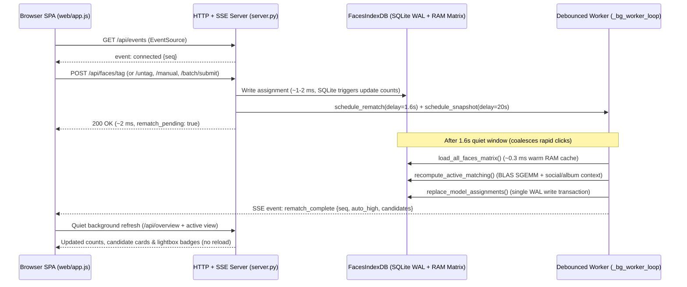

# Engineering & Operations Handover: Classroom Faces (`kinderpedia_backup.faces`)

- **Design Spec**: [`facial-recognition-design.md`](./facial-recognition-design.md)
- **Package Path**: [`../python/src/kinderpedia_backup/faces/`](../python/src/kinderpedia_backup/faces/)
- **Test Suite**: [`../python/tests/test_faces.py`](../python/tests/test_faces.py)
- **Status**: Production-verified (`120,000+` face archive, `< 2 ms` non-blocking tagging mutations, `~1.6 s` debounced background recompute + SSE live sync)

This handover document provides the complete technical map, database and concurrency invariants, tuning parameters, REST/SSE API surface, operational runbook, and extension hooks needed to maintain or extend the `faces` pipeline without prior context.

---

## 1. Architecture & Request Lifecycle Overview

The `faces` module operates strictly offline against any backup folder produced by either the **Browser Bookmarklet** or `kinderpedia-backup sync`. Original album folders (`<Child>/Albums/...`) are treated as **immutable read-only inputs**; all state lives in `Metadata/faces_index.sqlite`, `Metadata/face_thumbs/`, `Metadata/categorization_index.json`, and optional zero-copy hardlink exports in `ByChild/`.



---

## 2. Module-by-Module Map

All facial-recognition code lives under `python/src/kinderpedia_backup/faces/` and is wired into `python/src/kinderpedia_backup/cli.py` (`_add_faces_arguments` and `run_faces`).

| File | Responsibility | Key Entry Points |
| :--- | :--- | :--- |
| [`models.py`](../python/src/kinderpedia_backup/faces/models.py) | Immutable dataclasses shared across scanning, matching, and CLI output. | `BoundingBox`, `DetectedFace`, `PhotoProvenance`, `ScanSummary`, `OrganizeStats` |
| [`weights.py`](../python/src/kinderpedia_backup/faces/weights.py) | Downloads & SHA-256 verifies InsightFace `buffalo_l` ONNX weights (`det_10g.onnx`, `w600k_r50.onnx`) into OS cache (`~/.cache/kinderpedia-backup/models/buffalo_l`). | `default_models_dir()`, `ensure_buffalo_l_weights()`, `sha256_file()` |
| [`onnx_backend.py`](../python/src/kinderpedia_backup/faces/onnx_backend.py) | Dual-engine ONNX runtime wrapper: uses `onnxruntime` (`CPUExecutionProvider` / `CoreMLExecutionProvider`) when installed, falling back transparently to `opencv-python-headless` (`cv2.dnn`) on bleeding-edge Python (`3.14` / `3.15+`). | `ScrfdArcFaceRecognizer`, `_OrtRunner`, `_OpenCvDnnRunner` |
| [`alignment.py`](../python/src/kinderpedia_backup/faces/alignment.py) | Pure-NumPy `SCRFD-10GF` anchor decoding (`strides = 8, 16, 32`), greedy NMS, 5-point Umeyama similarity alignment (`112x112` ArcFace crop), and padded `160x160` portrait thumbnail cropping. | `letterbox_scrfd_input()`, `decode_scrfd_outputs()`, `align_face_112()`, `crop_face_portrait()` |
| [`recognizer.py`](../python/src/kinderpedia_backup/faces/recognizer.py) | `FaceRecognizer` structural `Protocol` (enabling zero-ML synthetic unit tests) and factory loader. | `FaceRecognizer`, `load_default_recognizer()`, `cosine_similarity()` |
| [`provenance.py`](../python/src/kinderpedia_backup/faces/provenance.py) | Joins disk JPEGs against `Metadata/<Child>/Albums/*.json` and `albums_index.json` by Kinderpedia `media_id` (`NNN_<media_id>.jpg`), extracts capture year, resolves working CDN URLs, and discovers `<Child>/avatar.png`. | `ProvenanceResolver`, `resolve_best_live_url()`, `discover_child_avatars()` |
| [`scanner.py`](../python/src/kinderpedia_backup/faces/scanner.py) | Incremental archive scanner (`(size_bytes, mtime_ns)` skip cache), parallel JPEG decoding/EXIF transpose, batched GPU/CPU inference, sharded `160x160` crop writer (`Metadata/face_thumbs/<xx>/<face_id>.jpg`), and reference portrait enrollment. | `run_archive_face_scan()`, `enroll_avatars_and_references()`, `ensure_face_thumb_on_disk()` |
| [`index_db.py`](../python/src/kinderpedia_backup/faces/index_db.py) | Thread-safe SQLite WAL persistence layer, trigger-maintained per-person summary counts, in-memory `(N, 512)` `float32` embedding matrix cache, cluster/batch/tag/manual-box mutations, portable JSON snapshot writer, CDN URL formatter, and `ByChild/` hardlink materializer. | `FacesIndexDB` |
| [`db/`](../python/src/kinderpedia_backup/faces/db/) | Modules behind the `FacesIndexDB` facade (linear mixin chain): `schema.py` (DDL + versioned migrations), `core.py` (connection, locks, meta, change signal), `people.py`, `matrix_cache.py`, `scan_repo.py` (re-link / re-key / delete), `assignments.py` (`_claim_face_locked`), `clusters.py`, `queries_ui.py`, `exports.py`, plus `codec.py`, `relink.py`, `scan_lock.py`. | `apply_migrations()`, `match_faces()`, `ScanLock` |
| [`matcher.py`](../python/src/kinderpedia_backup/faces/matcher.py) | Per-year quality-first clustering (`rebuild_yearly_clusters`) and multi-anchor longitudinal active-learning engine (`recompute_active_matching`) with batched BLAS `SGEMM`, hard-negative veto, `[Y-1, Y+1]` sibling guard, album burst propagation, social co-occurrence graph, and bipartite exclusivity. | `rebuild_yearly_clusters()`, `recompute_active_matching()`, `_build_social_context()` |
| [`server.py`](../python/src/kinderpedia_backup/faces/server.py) | Localhost-only (`127.0.0.1`) `ThreadingHTTPServer`, `X-KP-Token` CSRF guard, `< 20 ms` mutation handlers, debounced background rematch/snapshot worker thread (`_bg_worker_loop`), and `GET /api/events` SSE broadcaster. | `serve_faces_ui()`, `_AppContext`, `_FacesRequestHandler` |
| [`web/`](../python/src/kinderpedia_backup/faces/web/) | Vanilla HTML/CSS/JS single-page studio (`index.html`, `styles.css`, `app.js`) with 3 modes (Clusters, Batch Trainer, Confirmed Gallery), unified lightbox navigation (`state.modalNavContext`), mouse-drag manual bounding-box tagger, `EventSource` live sync, `runBusy()` button spinners, and backend auto-reconnect banner. | `init()`, `connectEventStream()`, `bindManualBoxDrawing()`, `renderModalNavControls()` |

---

## 3. SQLite Schema, Caching & Critical Invariants

Database location: `<backup_dir>/Metadata/faces_index.sqlite` (`PRAGMA journal_mode=WAL`, `PRAGMA foreign_keys=ON`).

### 3.1 Tables Overview

| Table | Primary Key / Unique Key | Purpose |
| :--- | :--- | :--- |
| `photos` | `photo_id` (`UNIQUE(rel_path)`) | File metadata (`size_bytes`, `mtime_ns`, `width`, `height`), Kinderpedia provenance (`account_child`, `album_id`, `album_title`, `album_date`, `photo_year`, `kp_media_id`), CDN URLs (`download_url`, `fullsize_url`, `thumb_url`, `best_live_url`), and `face_count`. |
| `faces` | `face_id` (`UNIQUE(photo_id, face_idx)`) | Pixel bbox (`bbox_top/right/bottom/left`), `det_score`, `quality_score`, `1,024`-byte `float16` L2-normalized embedding (`embedding_f16`), `cluster_id`, `suppress_auto`, and `is_manual`. |
| `people` | `person_id` (`UNIQUE(display_name COLLATE NOCASE)`) | Named profiles (`role` in `'family' \| 'classmate' \| 'staff' \| 'ignore'`, `account_folder`, `cover_face_id`). |
| `reference_seeds` | `seed_id` (`UNIQUE(source_path)`) | Embeddings extracted from `<Child>/avatar.png` (`weight = 0.55`) and `References/<Name>/*` (`weight = 1.0`). |
| `clusters` | `cluster_id` | Per-year unknown face clusters (`cluster_year`, `member_count`, `medoid_face_id`, `assigned_person_id`, `suggested_person_id`, `suggested_score`). |
| `assignments` | `(photo_id, person_id)` | Canonical relationship between a photo and a person: `face_id`, `status` (`'confirmed' \| 'auto_high' \| 'candidate' \| 'rejected'`), `source` (`'cluster_seed' \| 'batch_confirm' \| 'batch_disprove' \| 'manual_tag' \| 'reassigned' \| 'avatar_seed' \| 'model_auto' \| 'album_cohesion'`), `confidence`, and `is_anchor`. |
| `person_assignment_counts` | `person_id` | Trigger-maintained real-time counters (`confirmed_count`, `auto_high_count`, `candidate_count`, `rejected_count`, `anchor_count`) keeping `GET /api/overview` at `~1 ms` regardless of `assignments` table size. |
| `meta` | `key` | Schema/feature markers (`person_assignment_counts_v1`, `last_scan_at`, `last_rematch_at`). |

### 3.2 Five Architectural Invariants (Read Before Modifying `index_db.py` or `matcher.py`)

1. **Trigger-Maintained `person_assignment_counts`**:
   - Three SQLite triggers (`trg_assignments_ai_counts`, `trg_assignments_ad_counts`, `trg_assignments_au_counts`) automatically update `person_assignment_counts` on every `INSERT`, `DELETE`, and `UPDATE OF person_id, face_id, status, source ON assignments`.
   - If you ever modify the counting logic (for instance, changing what qualifies as an anchor in `anchor_count`), bump the `meta` key version (`person_assignment_counts_v1` -> `v2`) in `FacesIndexDB.__init__` so existing databases rebuild the summary table on startup.

2. **Zero-Vector Manual Bounding Boxes (`faces.is_manual = 1`)**:
   - When a user draws a box around an occluded child (`POST /api/faces/manual`), `create_manual_face_and_tag()` inserts a `faces` row with `face_idx >= 1000`, `is_manual = 1`, `suppress_auto = 1`, `embedding_f16 = bytes(dim * 2)` (all zeros), and `assignments.is_anchor = 0`.
   - **AI Isolation**: `load_all_faces_matrix()` filters `WHERE f.is_manual = 0`, and `load_anchors_and_negatives()` joins `LEFT JOIN faces f ON f.face_id = a.face_id AND f.is_manual = 0`. ArcFace matching and clustering never see manual boxes, and creating/deleting a manual box does **not** invalidate `_faces_matrix_cache`.
   - **Scan Safety & Cleanup**: `upsert_scanned_batch(..., force=True)` runs `DELETE FROM faces WHERE photo_id = ? AND is_manual = 0` so `--force` rescans never wipe manual user annotations. Conversely, untagging (`untag_face`) or rejecting (`tag_single_face(..., status='rejected')`) a manual face deletes the `faces` row and cleans up its cached JPEG in `Metadata/face_thumbs/`.

3. **Photo-Scoped vs. Face-Scoped Hard Negatives**:
   - Clicking `✗` on a card in the Batch Trainer writes `status = 'rejected', source = 'batch_disprove'`, which vetoes `(photo_id, person_id)` across the **entire photo**.
   - Reassigning a misidentified face (`↪`, `replace_person_id`) or untagging a face (`✗ Remove Tag`) writes `status = 'rejected', source = 'reassigned'` (and sets `faces.suppress_auto = 1` on untag). In `matcher.py`, `source = 'reassigned'` locks out **only `(face_id, person_id)`**, allowing the displaced child to still match their *actual* face elsewhere in the same classroom group photo on the very next sweep!

4. **`_Ignored_Background` (`role = 'ignore'`) Isolation**:
   - Profiles with `role = 'ignore'` are completely skipped during `recompute_active_matching()` and `rebuild_yearly_clusters()` (`suggested_person_id` never suggests an ignored profile). Their `confirmed` faces simply enter `claimed_confirmed_faces`, silently locking background bystanders out of every active child's candidate queue.

5. **Concurrency & Lock Ordering**:
   - `FacesIndexDB._lock` (`threading.RLock`) serializes SQLite cursor operations on the shared WAL connection.
   - `FacesIndexDB._faces_matrix_lock` protects lazy population of `_faces_matrix_cache` (`~250 MB` for `122k x 512` `float32`). Always acquire `_lock` only for the short SQL query inside `load_all_faces_matrix()`, never hold `_lock` across multi-second NumPy `SGEMM` operations in `matcher.py`.
   - `_AppContext._rematch_lock` ensures at most one background `recompute_active_matching()` runs at a time while HTTP threads continue reading/writing tags in `< 2 ms`.

---

## 4. Matching & Clustering Parameters (`matcher.py`)

| Parameter / Mechanism | Default Value | Location & Behavior |
| :--- | :--- | :--- |
| `auto_high_threshold` | `0.45` | Effective score `>= 0.45` promotes a face to `auto_high` (automatically included in galleries, hardlink exports, and URL exports). **Calibrated band:** scores in `[0.45, 0.60)` are only `auto_high` when the labelled-neighbour vote agrees **and** the nearest labelled face is `>= 0.52` similar; otherwise they stay `candidate` (historic decisions show 57–62 % rejections in that band without agreement). |
| `candidate_threshold` | `0.33` | Effective score in `[0.33, 0.45)` queues the face as `candidate` for the active-learning Batch Trainer. |
| `max_anchors_per_year` | `8` (best + second-best anchor blended with weight `0.35` when a person has `>= 4` anchors) | Farthest-point greedy diversity sampling per `(person_id, year)` bucket so poses (frontal, 3/4, profile, outdoor lighting) stay balanced without `O(N^2)` slowdown. |
| Longitudinal year window | `[Y - 1, Y + 1]` | Anchors within `±1` calendar year receive full weight (`0.78 * max_top1 + 0.22 * mean_top3`); distant years require `+0.06` higher similarity so younger siblings at age 3 do not cross-match an older sibling's age-3 anchors from 3 years earlier. |
| Hard-negative penalty | `sim >= 0.58` | Confirmed `rejected` face embeddings penalize lookalike twin/classmate faces by `0.38 * max(0, neg_sim - 0.50)` (up to `-0.16`). |
| Album cohesion & bursts | `0.55` | When a child is confirmed or `>= 0.54` in an album, faces with same-album similarity `>= 0.55` (raised from 0.42 after a holdout showed it halves wrong trusted matches) promote to `auto_high`; kNN candidate→trusted promotion additionally needs score `>= auto_high - 0.05`; adjacent sequence photos (`seq_num ± 2`) propagate down to `0.38` (`source = 'album_cohesion'`). |
| Social co-occurrence | `+0.030` / `-0.045` | Built from intimate (`2–8` face) high-confidence photos (`intimacy = 2.0 / sqrt(face_count)`). Frequent playmates grant up to `+0.030` boost on ambiguous `[0.29, 0.52]` faces; isolated social circles (`>= 12` intimate photos, zero overlap, e.g. separate sibling classrooms) apply `-0.045`. |
| Yearly clustering | `sim_threshold = 0.56` | Connected-components + iterative medoid refinement (`refine_threshold = 0.54`) inside each `photo_year` bucket (`quality_score >= 0.24`, `min_cluster_size = 3`). |

---

## 5. Local HTTP & SSE API Reference (`server.py`)

Bound strictly to `127.0.0.1:<port>` (default `8765`). Every `POST` and `PATCH` request must include the session CSRF token header `X-KP-Token: <token>` injected into `index.html` (`window.__KP_CSRF_TOKEN__`).

### 5.1 Read & Streaming Endpoints (`GET`)

| Route | Description |
| :--- | :--- |
| `GET /` | Serves `web/index.html` with injected `window.__KP_CSRF_TOKEN__`. |
| `GET /assets/styles.css`, `/assets/app.js` | Serves static SPA stylesheet and JavaScript (`Cache-Control: no-store`). |
| `GET /media/face/<face_id>.jpg` | Serves `160x160` portrait thumbnail (lazily cropped on cache miss via `ensure_face_thumb_on_disk`, working identically for detected and manual boxes). |
| `GET /media/photo/<photo_id>` | Serves original full-resolution album photo (`Cache-Control: max-age=86400`). |
| `GET /api/events` | **Server-Sent Events (`text/event-stream`)** channel. Immediately flushes `event: connected`, sends `: keepalive` comments every `15s`, and broadcasts `rematch_started`, `rematch_complete`, and `snapshot_complete`. |
| `GET /api/overview` | Archive totals (`photos`, `faces`, `categorized_faces`, `clusters`), per-person counts (`person_assignment_counts`), `rematch_pending`, and `rematch_seq` (`~1 ms`). |
| `GET /api/batch?person_id=<id>&size=24&mode=boundary` | Active-learning batch proposal (`boundary` uncertainty/diversity sampling or `top` confidence) + top social classroom peers. |
| `GET /api/clusters?year=<YYYY>&include_assigned=0` | Unknown (or assigned) per-year face clusters with sample face IDs and `suggested_person_id` hints. |
| `GET /api/clusters/<cid>/faces?limit=160` | Member faces for cluster inspection modal (`←` / `→` keyboard stepping). |
| `GET /api/gallery?person_id=<id>&status=all&year=<YYYY>&offset=0&limit=120` | Paginated gallery items (`confirmed` + `auto_high`, or filtered) with Kinderpedia provenance and CDN URLs. |
| `GET /api/photos/<photo_id>` | Full photo detail, all bounding boxes (detected + manual) with current assignments/suggestions, and `people` list. |
| `GET /api/faces/<face_id>/photo` | Resolves `face_id` to full `get_photo_detail(photo_id)` + `highlight_face_id`. |
| `GET /api/export-urls?person_id=<id>&format=txt\|csv\|json&include_candidates=0` | Downloads deduplicated Kinderpedia CDN URLs (`Content-Disposition: attachment`). |

### 5.2 Mutation & Export Endpoints (`POST` / `PATCH`)

All tagging mutations commit to SQLite in `< 5 ms`, call `ctx.schedule_rematch()` (`1.6s` debounce) + `ctx.schedule_snapshot()` (`20s` throttle), and return `"rematch_pending": true` immediately.

| Route | Body Summary | Behavior |
| :--- | :--- | :--- |
| `POST /api/faces/tag` | `{photo_id, face_id?, box?, person_id\|person_name, status?, replace_person_id?, role?}` | Confirms or rejects a face tag (`~1.8 ms`). When `replace_person_id` is passed, atomically demotes the displaced child on that `face_id` with `source='reassigned'`. If `face_id` is omitted and `box` is provided, delegates to manual box creation. |
| `POST /api/faces/untag` | `{photo_id, face_id}` | Removes tag from `face_id`. Sets `suppress_auto = 1` on detected faces (and writes `source='reassigned'` lockout for any prior owner), or deletes the row completely if `is_manual = 1`. |
| `POST /api/faces/manual` | `{photo_id, box:{left,top,right,bottom}, person_id\|person_name, role?}` | Inserts a zero-vector manual bounding box (`is_manual = 1, suppress_auto = 1, is_anchor = 0`), generates its `/media/face/<id>.jpg` crop, and confirms the tag (`is_anchor = 0`). |
| `POST /api/batch/submit` | `{person_id, decisions:[{photo_id, face_id, decision}]}` | Commits a batch of `'confirm'`, `'reject'` (hard negative), and `'unsure'` decisions in one SQLite transaction. Returns next batch immediately from current candidates while background rematch runs. |
| `POST /api/clusters/<cid>/assign` | `{person_id\|person_name, role?}` | Bulk-confirms all non-manual faces in cluster `cid` (`up to 16` diverse anchors marked `is_anchor = 1`). |
| `POST /api/clusters/<cid>/remove-face` | `{face_id}` | Removes a single outlier `face_id` from `cid` (and clears its cluster assignment if already assigned). |
| `POST /api/people` | `{display_name, role?}` | Creates or returns a named profile. |
| `PATCH /api/people/<pid>` | `{display_name?, role?}` | Renames a profile in place or updates its `role`. If `display_name` matches an existing profile (case-insensitive), merges `pid` into that profile (`merge_people`) after merging assignments cleanly. |
| `POST /api/recluster` | `{sim_threshold?: 0.56, min_cluster_size?: 3}` | Synchronous administrative rebuild of per-year unknown clusters + active matching + JSON snapshot. |
| `POST /api/materialize` | `{output_dir?, link_mode?: "hardlink"\|"copy", include_candidates?: false}` | Flushes `Metadata/categorization_index.json` and builds `<backup_dir>/ByChild/<Person>/<YYYY-MM-DD>__<Album>__<File>.jpg` hardlinks (skipping `role = 'ignore'`). |
| `PATCH /api/people/<pid>` (`birth_date`) | `{birth_date: "YYYY-MM-DD" \| ""}` | Sets/clears a birthday; returns `birthday_removed` (tags on earlier photos deleted immediately). |
| `DELETE /api/people/<pid>` | — | Deletes the profile; its faces become uncategorized, its manual boxes (and thumbs) are removed. Family children with `avatar.png` / `References/` are re-enrolled by the next `faces scan`. |
| `GET /api/people/<pid>/clusters?threshold=0.50&min_size=3` | — | Per-child visual sub-clusters per year (see design doc layer 10). |
| `POST /api/people/<pid>/cluster-action` | `{action: "exclude"\|"boost"\|"penalize"\|"clear", faces:[{photo_id, face_id}]}` | Hard exclude or soft ± pressure (`person_face_pressure`). |
| `GET /api/classes`, `GET /api/classes/matrix` | — | Classes list; membership matrix with per-class photo counts and per-person tag counts (hints). |
| `POST /api/classes`, `PATCH /api/classes/<cid>`, `DELETE /api/classes/<cid>` | `{name, archive_child, start_date, end_date}` | Class CRUD (feed + date window). |
| `POST /api/classes/auto` | `{}` | One class per feed × school year (Sep 1 – Aug 31) with ≥ 5 photos. |
| `POST /api/classes/<cid>/members` | `{person_ids: [...]}` | Replaces the member set; triggers rematch. |

### 5.3 Eligibility Invariants (Birthdays & Classes)

- `photo_date_ord()` (in `index_db.py`) is the single definition of a photo's date (earliest of `album_date` / `image_dateadd`, else last day of the folder month, else "unknown" = never excluded). The matcher uses the cached `date_ords` array; SQL paths use `_photo_ord_and_feed_locked()`.
- Birthday is enforced everywhere (matcher, cluster suggestions, cluster confirm, batch approve, manual tag/box → HTTP 400). Classes are enforced for automatic paths only (matcher, cluster suggestions, cluster confirm); explicit single manual tags are allowed.
- People with zero class memberships are unrestricted — adding the first membership is what turns the restriction on.

---

## 6. Operations Runbook

### 6.1 Routine Incremental Workflow (After New School Uploads)

```bash
# 1. Pull newly posted Kinderpedia albums/videos/documents:
kinderpedia-backup sync --output ~/kinderpedia_bk   # incremental by default; --refresh-index forces a full re-listing

# 2. Incrementally scan only new photos (already-indexed JPEGs skip in milliseconds)
#    and auto-match against existing child anchors + refresh categorization_index.json:
kinderpedia-backup faces scan --input ~/kinderpedia_bk

# 3. (Optional) Review borderline candidates or tag occluded faces in the Web Studio:
kinderpedia-backup faces ui --input ~/kinderpedia_bk --port 8765

# 4. Refresh zero-copy hardlink folders in ~/kinderpedia_bk/ByChild/<Person>/:
kinderpedia-backup faces materialize --input ~/kinderpedia_bk
```

### 6.2 Lightbox & Keyboard Shortcuts in `faces ui`

- **Batch Trainer (`Step 2`)**: Click any card to cycle `✓ Match` -> `✗ Not <Person>` -> `? Unsure` (`Shift`-click toggles a range; `↪` reassigns directly to another classmate; `🔍` opens the photo lightbox across all 24 batch cards; `Enter` submits the batch).
- **Unified Lightbox (`Cluster`, `Batch`, or `Gallery`)**:
  - `←` / `→`: Step across the active cluster, the 24 batch candidates, or the confirmed gallery without closing the modal; the scrollable face thumbnail strip updates badges live.
  - `T` (or **`+ Tag Child (T)`**): Crosshair drag mode on the photo — drag a box over an occluded child (back of head, hat, costume) and click a child chip to confirm a manual tag.
  - `Esc`: Layered cancel (closes active manual box popover -> exits draw mode -> closes reassign modal -> closes lightbox).

### 6.3 Pre-Commit Quality, Type & Zero-PII Verification

Before committing or pushing any changes to the repository, run the full local CI gate from `python/`:

```bash
cd python
ruff check src tests kinderpedia.py
mypy src tests kinderpedia.py
pytest -q
node --check src/kinderpedia_backup/faces/web/app.js
```

If `gitleaks` is installed locally, also run:

```bash
gitleaks detect --source .. --verbose
```

---

## 7. Ready Extension Hooks (Roadmap)

1. **Standalone Cloud Downloader from Portable Manifest**:
   - `Metadata/categorization_index.json` and `kinderpedia-backup faces export-urls` already emit deduplicated `best_live_url` values (automatically selecting `fullsize_url` on pre-2024 albums where Kinderpedia's `download_url` returns HTTP 404, and `download_url` on 2024+ full-res originals). A lightweight script or `curl -Z` / `aria2c -i <person>_urls.txt` can pull a single child's photos onto another device without copying the multi-gigabyte archive.
2. **Classroom Video Keyframe Face Indexing**:
   - `Metadata/<Child>/videos_index.json` and day-matched `.mp4` files live alongside the photo albums. Sampling `1 fps` keyframes via `ffmpeg` into `ScrfdArcFaceRecognizer` and storing keyframe timestamps in a companion `video_faces` table can reuse `FacesIndexDB` anchors and `recompute_active_matching()` directly.

---

## 8. Data-Layer Hardening (schema v5)

- **Schema versioning.** `meta.schema_version` + ordered idempotent migrations in `faces/db/schema.py` run once per DB inside `BEGIN IMMEDIATE` (safe when `faces scan` and `faces ui` open the file concurrently). v1 baseline + legacy column probes, v2 counts triggers, v3 the former on-every-open `ignore`-role repair (now one-time), v4 `photos.content_hash` + `trg_faces_ad_refs` (deleting a face nulls `people.cover_face_id` / `clusters.medoid_face_id`, i.e. `ON DELETE SET NULL` without a table rebuild), v5 `BEFORE INSERT/UPDATE` triggers enforcing the `status` / `source` / `role` enums (generated from the `Literal` types; a test fails if a new literal is added without a migration).
- **Label-preserving rescans.** Skip = same `(size, mtime, model_id)`. Same size but new mtime -> compare the head/tail BLAKE2b fingerprint (`storage.file_fingerprint`), only real content changes rescan. A `model_id` change (`--det-size`, the `_align2` bump, a new embedder) or `faces scan --force` rescans **with re-link**: old faces are matched to new detections (bbox IoU >= 0.5, then cosine >= 0.9) and updated in place, so `face_id`, assignments, anchors, `suppress_auto`, pressure, cluster and cover/medoid references survive. Unmatched old faces are deleted; their human labels stay as photo-level rows (`face_id NULL`) and are counted in `meta.orphaned_face_labels_total`.
- **Reconciliation.** Vanished paths are re-keyed onto renamed/moved files (same fingerprint, or same Kinderpedia image id + size) keeping `photo_id`; the rest are deleted child-first (counts stay exact) unless more than `max(100, 10 %)` of the index would go (unmounted archive guard; `--prune-missing` / `--keep-missing` override).
- **One claim primitive.** `_claim_face_locked` backs batch approve, cluster confirm, batch reassign, `tag_single_face` and manual boxes. Another person's human `confirmed` tag is never deleted: bulk paths skip it (`apply_batch_decisions(...)["skipped_conflicts"]`), explicit single-face actions demote it to a `rejected`/`reassigned` face negative.
- **Scan <-> UI.** `faces scan` holds `Metadata/faces_scan.lock` (pid + heartbeat, stale locks taken over; `--lock-timeout`). `FacesIndexDB.get_data_version()` is an opaque token (`PRAGMA data_version` + scan generation) that only changes on other processes' commits or at scan end; `get_scan_status()` exposes a running scan; `meta.last_scan_at` is stamped on success.
- **Memory / locking.** `load_all_faces_matrix` streams into a preallocated float32 matrix (peak ~3x lower); `materialize_flat_folders` does its filesystem pass without `_lock` and prunes dangling symlinks and orphan person folders (links only, inside `ByChild/`); `get_person_face_clusters` caps the per-year pairwise matrix (`max_pairwise_faces=4096`). Face thumbnails are written atomically and decoded with `Image.draft` + crop-before-convert.
- **Batch queue.** `default_approve_min_sim = 0.50`; cards carry `default_decision` (`approved` / `unsure` for 0.38-0.50 / `disproved`), `source`, and ~2 random trusted (`album_cohesion` / `model_trusted`) rows per 24 flagged `"audit": true`.
- `faces/pipeline.py` (legacy JSON reference-folder organizer, no production callers) was removed.


## 9. Server, Jobs & Matcher Changes (assessment follow-up)

- **Background jobs.** `POST /api/recluster` and `POST /api/materialize` return `202 {job_id, kind, label, state}` immediately; a second job of the same kind gets `409 {error, job}`. Progress/results arrive via SSE `job_status` / `job_complete` (`{ok, result | error, elapsed_ms}`), `GET /api/jobs` and `GET /api/jobs/<id>`. `bg_status` carries `jobs[]` and `external_changes`; the top-bar chip shows running jobs. Recluster runs under `_rematch_lock`.
- **Child clusters.** `GET /api/people/<pid>/clusters` is cached per `(person, threshold, min_size, completed_rematch_seq, data_epoch)` and returns the first 12 faces per cluster (`faces_truncated`, `signature`, `faces_preview`; `faces_limit=0` for all). `GET /api/people/<pid>/clusters/faces?key=&threshold=&min_size=&offset=` serves the rest from the cache.
- **HTTP.** HTTP/1.1 keep-alive (SSE uses `Connection: close`). Errors: `400` validation, `404` missing, `409` job conflict, `503 {retryable: true}` + `Retry-After` for `database is locked`, `500` otherwise (logged). The client only shows "backend offline" on real network errors / 502 / 504.
- **External writers.** A watcher (`_AppContext(external_poll_sec=3)`) compares `db.get_data_version()`; when another process (e.g. `faces scan`) committed, caches and the kNN neighbour cache are dropped, SSE `data_changed` is sent and a rematch scheduled. While a scan holds its lock the refresh is deferred until the scan ends.
- **Batch cards** honour the server's `default_decision`; `audit: true` cards show an "audit" badge; skipped conflicting approvals are reported in the toast.
- **Alignment / model.** `align_face_112` now matches the OpenCV `warpAffine` pixel convention used to train ArcFace (embedding agreement with the reference pipeline: min 0.959 → 0.995). `model_id` is `scrfd_10g_<det>_arcface_r50_v1_align2`; changing it triggers a label-preserving rescan (§8).
- **onnxruntime.** The `faces` extra installs `onnxruntime>=1.17` on Python < 3.15 (no 3.15 wheels yet); with it the CoreML/CUDA providers are used (~9x faster scans on Apple Silicon than the OpenCV DNN fallback). The selected engine is logged at scan start.
- **Matcher speed.** Cold rematch ~13 s (was ~21 s), warm ~2.3 s (was ~3.3 s); yearly clustering ~9 s (was ~28 s). `recompute_active_matching(..., diagnostics={})` returns per-stage timings for evaluation.
