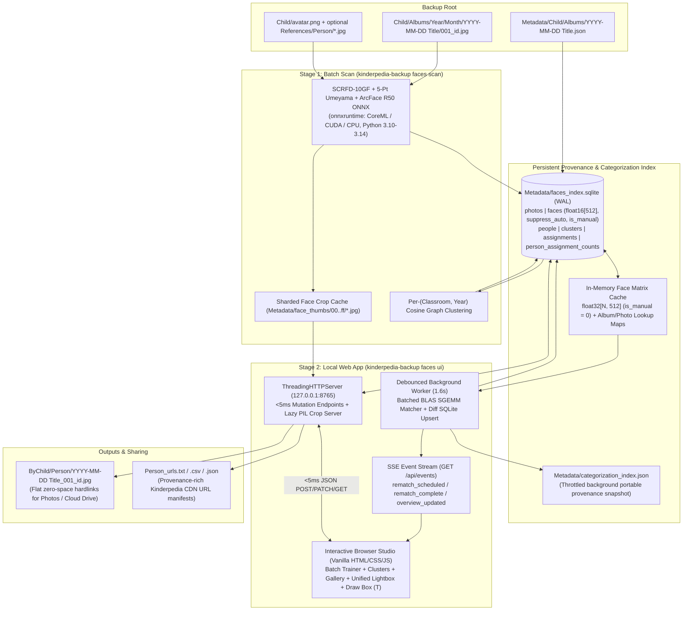

# Local Facial Recognition, All-Classroom Index & Active-Learning Web UI — Design Doc

**Status:** Implemented (`python/src/kinderpedia_backup/faces/`)  
**Scope:** Offline SCRFD + ArcFace ONNX inference (`onnxruntime`), per-year classroom clustering, `<20ms` non-blocking active-learning Web UI with Server-Sent Events (SSE), unified lightbox navigation, manual occluded-child bounding-box tagging, year-windowed sibling guard, hard-negative lookalike suppression, same-album outfit cohesion, social peer co-occurrence, flat hardlink materialization, and provenance-rich Kinderpedia URL export. *(Photos only in v1.)*

---

## 1. Core Workflow: "This IS `<Child>`" → Batch Approve / Disprove / Tag

Rather than reviewing thousands of group photos one at a time, `kinderpedia-backup faces ui` centers on an **active-learning batch confirmation loop** designed to categorize **every child in the classroom** with sub-`5ms` click latency and steadily decreasing false guesses:

1. **Seed Any Child in 1 Click:**
   - Family children auto-seed from `<Child>/avatar.png` (plus optional `References/<Person>/`).
   - Recurring classmates surface automatically in the **Unnamed Kids & Years** discovery grid (clustered per classroom & year, ranked by photo count, with outlier-photo exclusion before cluster confirmation), or by clicking/drawing a face bounding box inside any classroom photo.
   - Any person can be renamed in place, assigned a role (`family`, `classmate`, `educator`, `ignore`), or merged into another profile via `PATCH /api/people/<id>`.
2. **Batch Proposal ("Approve All Except 1–2 Mistakes"):**
   - The local Python backend serves a diversified batch of **24 proposed matches** (`max_per_album = 2`) for the selected child, pre-selected as **Approved `✓`** when confidence is strong.
   - Every card supports four quick decisions:
     - **`✓` Approved** (`confirmed`): adds the photo to the child's gallery and contributes pose/year-diverse positive anchors.
     - **`✗` Disproved** (`rejected`): records a **hard negative** for that child so lookalike classmates are suppressed across the archive.
     - **`?` Not Sure** (`unsure`): safely skips ambiguous/blurry crops from the review queue without teaching positive or negative anchors.
     - **`↪` Reassign ("Actually another child…")**: immediately re-tags the face box to another existing or new child (`replace_person_id`), records a **face-scoped hard negative** (`source = 'reassigned'`) so the displaced child can still match a *different* face in the same group photo, and refreshes `cover_face_id` if displaced.
3. **Unified Full-Photo Lightbox & Manual Occluded-Child Tagging (`+ Tag Child` / `T`):**
   - Opening any photo from **Batch Trainer**, **Unnamed Clusters**, or **Confirmed Gallery** reuses a single unified navigation context (`state.modalNavContext`) with `←` / `→` keyboard stepping, a scrollable thumbnail strip showing live `✓` / `✗` / `?` / `↪` badges, and inline quick-decision pills.
   - Any auto-detected face tag can be cleared via **`✗ Remove Tag`** (`POST /api/faces/untag`), leaving the face uncategorized with `suppress_auto = 1` so background sweeps never slap a runner-up guess back onto it.
   - When a child is turned away, wearing a costume hood, or missed by SCRFD, clicking **`+ Tag Child`** (or pressing `T`) lets the user drag a bounding box directly on the photo and pick a name chip. Manual boxes store a zero vector with `is_manual = 1, is_anchor = 0`, reusing all `/media/face/<id>.jpg` crop and `ByChild/` export logic while remaining 100% invisible to ArcFace biometric matching and clustering.

---

## 2. System Architecture & Real-Time Non-Blocking Pipeline



### `<20ms` Click Responsiveness & Background Sync Design

1. **Immediate HTTP Mutations (`~2ms`):**
   - `POST /api/faces/tag`, `POST /api/faces/untag`, `POST /api/faces/manual`, `POST /api/batch/submit`, `POST /api/clusters/<id>/assign`, and `PATCH /api/people/<id>` commit only the point SQLite change, read the 24-row trigger-maintained `person_assignment_counts` summary table, call `schedule_rematch()`, and return immediately.
2. **In-Memory Embedding Matrix & Batched BLAS `SGEMM`:**
   - `FacesIndexDB.load_all_faces_matrix()` caches the unpacked read-only `float32[N, 512]` auto-detected face matrix (`WHERE is_manual = 0`) plus pre-indexed `rows_by_album`, `fc_by_photo`, and `rows_by_photo` maps in RAM (`~0.3ms` warm vs `~870ms` SQLite BLOB unpack), reading live `suppress_auto` flags on each sweep.
   - `recompute_active_matching()` stacks positive and hard-negative anchor matrices across all active people into `<=512`-column single-pass BLAS `SGEMM` batches (`embs @ stacked_pos.T`) and writes only changed model rows via an in-memory diff against `assignments`.
3. **Debounced Worker + Server-Sent Events (`GET /api/events`):**
   - Rapid clicks within `1.6s` coalesce into a single background rematch sweep; portable `Metadata/categorization_index.json` writes are throttled separately (`20s` debounce + flush on shutdown/materialize).
   - When a background sweep completes, the server broadcasts `event: rematch_complete` over `GET /api/events` (`EventSource`), allowing `app.js` to refresh sidebar counters, open photo modals (preserving any in-progress input focus), and candidate queues without page reloads or cursor jumps.

---

## 3. Child-Matching Intelligence Layers

1. **SCRFD-10GF + ArcFace R50 on ONNX Runtime (Python 3.10–3.14):**
   - Runs `det_10g.onnx` + 5-point Umeyama similarity alignment + `w600k_r50.onnx` via `onnxruntime` (`CUDA` / `CoreML` / `CPU`).
   - Quality gate (`det_score >= 0.55` and `min(width, height) >= 28 px`) filters out classroom wall posters, cartoons, and dolls.
2. **Multi-Epoch Diverse Pose Anchors:**
   - Selects up to `max_anchors_per_year = 8` pose-diverse confirmed exemplars per `(person, year)` (`cos_sim < 0.88` diversity preference) rather than averaging toddler and preschool faces into a single blurry centroid.
3. **Year-Windowed Sibling Guard (`[Y-1, Y+1]`):**
   - Siblings at the same biological age (e.g., Older Sibling at age 2 in `2022` vs. Younger Sibling at age 2 in `2026`) look very similar to ArcFace. Scoring a photo from year $Y$ prioritizes anchors within $[Y-1, Y+1]$, applying a cross-era penalty (`0.06`) to distant-year anchors whenever nearby-year anchors exist.
4. **Hard-Negative Lookalike Suppression (Photo-Level & Face-Scoped):**
   - Disproved or removed faces (`status = 'rejected'`) form a per-person negative bank (the most recent `512`). Unreviewed faces strongly matching it (`neg >= 0.58` and closer to the negative than to the child's anchors) are penalized so a lookalike classmate only needs to be rejected once or twice.
   - **Soft negative tier:** faces with `neg >= 0.45` that are about as close to a removed/rejected face as to the child's own anchors (`neg >= pos - 0.02`) get a graded push-down of up to `-0.10`, so removing a tag also nudges the wider ring of similar-looking faces.
   - Reassigned or untagged boxes record `source = 'reassigned'`, locking out only `(face_id, person_id)` rather than `(photo_id, person_id)` so the displaced child can immediately match their actual face box elsewhere in the same group photo.
5. **Same-Album Outfit / Burst Cohesion & Album-Diversified Batches:**
   - Confirming even a single photo of child $P$ inside album $A$ scores all other faces in $A$ directly against that local outfit/lighting anchor (never diluted by global per-year anchor caps) and auto-absorbs clear burst matches (`source = 'album_cohesion'`) into $P$'s gallery without cluttering the manual review queue.
5b. **Temporal Cohesion (±3 days):**
   - Confirmed faces from the same few days (same haircut, outfit, season, lighting) act as extra local anchors that are never diluted by per-year anchor caps. A face's score is lifted to its best near-day match (discounted `0.02 + 0.02 × |Δdays|`) plus up to `+0.04` when that match is `>= 0.50` (raised from 0.40: at 0.40 same-day photos of *other* children were pulled into a child's queue after every batch, making the queue grow after submitting mostly rejections). Applied before hard negatives so rejections still win.
   - Holdout check on the real archive (15% of confirmed tags hidden, then re-matched): correct auto-tags 95.9% → 97.6%, wrong auto-tags 123 → 63.
6. **Social Peer Co-Occurrence & Small-Photo Cross-Circle Suppression:**
   - Learns a weighted social graph from confirmed appearances across intimate classroom photos (`2–8` faces). When classmate $Q$ (who regularly co-occurs with $R$) appears in a small group photo, $R$ receives up to `+0.030` peer boost while siblings/children from disjoint classroom circles receive up to `-0.045` suppression — tapering smoothly to `0` on larger events (`>= 9` faces) where classes and siblings mingle.
7. **Global Photo-Level Bipartite Exclusivity & `ignore` Role Isolation:**
   - Enforces at most 1 face box per active person and 1 active person per face box in every photo. Profiles with `role = 'ignore'` (e.g., `_Ignored_Background`) never pollute cluster name suggestions, peer graphs, or coverage percentages.
8. **Zero-Vector Manual Box Biometric Isolation (`is_manual = 1`):**
   - User-drawn boxes for occluded/costumed children store `is_manual = 1, suppress_auto = 1` with a zero `float16[512]` vector and `is_anchor = 0`. Both `load_all_faces_matrix()` (`WHERE is_manual = 0`) and `load_anchors_and_negatives()` (`LEFT JOIN faces ... AND is_manual = 0`) exclude them from biometric scoring while keeping their `(photo_id, person_id)` confirmation active for exports, thumbnails, and social peer co-occurrence.

8b. **Learned Label Vote (k-nearest labelled faces) — Trust & Veto:**
   - Every human-confirmed face of every profile (including `ignore` background profiles) is a voter. For each still-open face, the 15 most similar labelled faces vote (weight `(sim - 0.20)^2`).
   - **Veto:** if ≥ 80% of the vote (and a neighbour with `sim >= 0.45`) says *someone else*, or the closest labelled neighbour is a background face (`sim >= 0.55`), the face is removed from the other children's queues.
   - **Trust:** if ≥ 90% of the vote agrees with the matcher's `auto_high` pick (and the face is not closer to one of that child's rejected faces), the match is stored as `source = 'model_trusted'` and skips manual review (counted with album-cohesion autos). Candidates with ≥ 95% agreement are promoted.
   - Neighbour lists are cached across rematches and updated incrementally (new labels merged with one small SGEMM), so the warm rematch costs ~3 s; the cold build (~25 s) runs once in the background at `faces ui` start.
   - Holdout on the real archive (20% of labels hidden): wrong auto-tags on hidden confirmed faces 138 → 33, background faces auto-tagged to a child 276 → 111, review queue 40.4k → 27.5k while trusted matches rose 9.1k → 15.8k (≈ 0.3% wrong among trusted).
8b2. **Label-Consistency Guard (suspicious confirmed labels) — always on:**
    - Per `(person, year)` with `>= 8` confirmed faces, a confirmed label whose best cosine similarity to any *other* confirmed face of that person-year is `< 0.40` is *suspicious* (`faces/label_guard.py`; background `ignore` profiles are never checked).
    - A suspicious label keeps its tag and stays locked (the user decides), but is **never positive evidence**: not a per-year anchor, not an album-cohesion or temporal (±3 days) anchor, and **not a kNN voter** (it is removed from the voter bank). One wrong bulk confirm therefore cannot pull its look-alikes into a child's gallery or vote for them.
    - Review: `GET /api/people/<pid>/suspicious` lists them (most suspicious first); **Keep** (`POST /api/people/<pid>/suspicious/<face_id>/keep`, stored in `label_keeps`, schema v6) marks a label reviewed-OK so it counts as a normal anchor / voter again; **Untag** uses the existing `POST /api/faces/untag` (face-scoped negative).
    - Why it is on: label hygiene, **not** a measured accuracy gain. On the stratified 5-fold hidden-label replay (2 seeds) every guard setting ties with the guard off (precision 96.36 ± 0.11 %, recall 67.65 ± 0.12 %; the chosen setting costs 7 of ~38k correct auto-accepts). On this archive it flags 17 of ~28k labels; a spot check found them to be mostly unusable biometric references (back of head, masks, hats + sunglasses, blur, a rotated group selfie) and 5 plausible hard poses — exactly the faces one does not want as anchors or voters. Replay table, spot check and the exact command: `docs/faces-handover.md` §10.
    - The kNN neighbour cache keeps 8 spare neighbours per row, so removing voters (untag, guard) stays exact without a cold rebuild.
8c. **Weak-Match Gate & Same-Album Absence:**
   - Borderline matches (below `auto_high + 0.05`) for a child with ≥ 25 labelled faces are dropped when that child gets < 30% of the labelled-neighbour vote while another identity tops it, so faces of non-eligible or unenrolled kids stop piling into the "least bad" child's queue.
   - In albums where a child is already confirmed, borderline faces whose best similarity to her confirmed faces *from that same album* is < 0.40 are dropped (genuine same-day matches score ~0.7–0.9; measured: 7% of individually confirmed matches fall below 0.40 vs. ~85% of the leftover queue).
   - Holdout: review queue 20.3k → 16.8k for a loss of ~0.3% of correct matches.
9. **Hard Eligibility: Birthdays & Class Memberships:**
   - Each photo gets a *latest possible capture date* (`photo_date_ord`): the earlier of `album_date` / `image_dateadd`, falling back to the last day of the `<Year>/<Month>` folder. It is cached per face as `date_ords` in the RAM matrix.
   - `people.birth_date`: a person is never matched, suggested, batch-approved, cluster-confirmed or manually tagged on a photo dated before it. Setting a birthday immediately deletes that person's existing non-rejected tags on earlier photos.
   - `school_classes` (`archive_child` feed + optional `[start_date, end_date]`) and `class_members`: a person with ≥ 1 membership is only auto-matched, suggested and cluster-confirmed on photos inside one of their classes, so children of unrelated classrooms (e.g. siblings' feeds) are never auto-tagged together. People without memberships stay unrestricted. Explicit single manual tags remain allowed. `POST /api/classes/auto` seeds one class per feed × school year (Sep 1 – Aug 31).
   - Applied as a final `-1.0` mask on the score matrix just before bipartite exclusivity.
10. **Per-Child Visual Clusters & Soft Pressure:**
    - `get_person_face_clusters()` groups everything attributed to a child (confirmed + auto + candidate + pressured faces) per year with density-leader grouping (`threshold` 0.42 / 0.50 / 0.58) followed by centroid merging (`threshold + 0.12`); undersized groups fall into a per-year loose bucket (~0.2 s for an 11k-face child).
    - Actions: **Exclude** (face-scoped `rejected` / `reassigned` hard negatives), **Boost** (`person_face_pressure.weight = +1`: up to `+0.06` on faces with `sim ≥ 0.40` to the boosted set, without confirming), **Penalize** (`weight = -1`: up to `-0.12` on faces with `sim ≥ 0.42`, without rejecting), **Clear**.

---

### Calibration: hidden-label replay (`python -m kinderpedia_backup.faces.evaluate`)

Matcher thresholds and the guard are calibrated offline on a **copy** of the index (the tool copies the DB with the SQLite backup API first and refuses a `Metadata/faces_index.sqlite` path unless `--i-know-this-is-a-copy`). Protocol (also in `--help`):

1. Decision units are faces carrying human decisions (confirms of every source, batch rejects, untag / reassign negatives, unsure). Truth = confirmed person; rejected persons are known negatives.
2. Faces are stratified by `(kind, person, year)` with kind = `cluster` (cluster_confirm, ~88 % of faces) or `batch`, shuffled with a fixed seed and dealt into k = 5 folds, so each fold hides a matching share of batch decisions **and** of bulk cluster confirms of every person-year.
3. Per fold, all human decisions on the fold's faces are removed (plus pressure / keep marks, `suppress_auto` cleared), the matcher re-scores, and only hidden faces are scored: auto-accept precision (wrong = other person, background face or hidden rejection), recall, per score band / channel, background faces auto-tagged, hidden rejections re-accepted, flagged-label count, and the human reject rate per score band (threshold check).
4. Mean over folds × seeds ± SE; deltas vs the guard-off baseline are paired per replicate. Selection: a cell is non-losing if its paired precision delta is within one SE **or** its 95 % Wilson interval overlaps the baseline's; among non-losing cells the highest recall wins, ties go to the simpler cell (lower `min_faces`, then lower `min_sim`). When everything ties (as for the guard), the shipped values are picked by flagged-set quality (spot check).

The full grid (25 cells × 10 replicates) runs in ~15 min on the 122k-face archive (score matrix and kNN neighbour lists are reused across grid cells of a fold); the default run (current policy + baseline, 5 folds) takes ~3.5 min (200 s measured).

**Guard grid replay** (stratified 5-fold × seeds 1, 2 = 10 replicates, ≈ 6,313 hidden faces per replicate out of 31,568 decision faces; ± = SE over replicates; Δ paired vs guard-off; `det_penalty` 0 / 0.05 / 0.10 gave **bit-identical** results in every cell, so that knob was removed and is not shown):

| cell | precision % (mean ± SE) | recall % (mean ± SE) | Δprecision pp (paired) | Δrecall pp (paired) | P / R % seed 1; seed 2 | auto ok / wrong | flagged labels / fold | verdict |
|---|---|---|---|---|---|---|---|---|
| guard-off (baseline) | 96.36 ± 0.11 | 67.65 ± 0.12 | - | - | 96.30 / 67.67; 96.42 / 67.63 | 37959 / 1435 | 0.0 | baseline |
| sim=0.25 faces=4 | 96.36 ± 0.11 | 67.65 ± 0.12 | +0.000 ± 0.000 | +0.000 ± 0.000 | 96.30 / 67.67; 96.42 / 67.63 | 37959 / 1435 | 2.4 | tie |
| sim=0.25 faces=8 | 96.36 ± 0.11 | 67.65 ± 0.12 | +0.000 ± 0.000 | +0.000 ± 0.000 | 96.30 / 67.67; 96.42 / 67.63 | 37959 / 1435 | 1.8 | tie |
| sim=0.30 faces=4 | 96.36 ± 0.11 | 67.65 ± 0.12 | +0.000 ± 0.000 | +0.000 ± 0.000 | 96.30 / 67.67; 96.42 / 67.63 | 37959 / 1435 | 5.4 | tie |
| sim=0.30 faces=8 | 96.36 ± 0.11 | 67.65 ± 0.12 | +0.000 ± 0.000 | +0.000 ± 0.000 | 96.30 / 67.67; 96.42 / 67.63 | 37959 / 1435 | 2.7 | tie |
| sim=0.35 faces=4 | 96.36 ± 0.11 | 67.65 ± 0.12 | -0.000 ± 0.000 | -0.004 ± 0.002 | 96.30 / 67.67; 96.42 / 67.62 | 37957 / 1435 | 9.6 | tie |
| sim=0.35 faces=8 | 96.36 ± 0.11 | 67.65 ± 0.12 | -0.000 ± 0.000 | -0.002 ± 0.002 | 96.30 / 67.67; 96.42 / 67.63 | 37958 / 1435 | 5.3 | tie |
| sim=0.40 faces=4 | 96.36 ± 0.11 | 67.64 ± 0.12 | -0.001 ± 0.000 | -0.014 ± 0.006 | 96.30 / 67.66; 96.42 / 67.61 | 37951 / 1435 | 19.8 | tie |
| sim=0.40 faces=8 | 96.36 ± 0.11 | 67.64 ± 0.12 | -0.001 ± 0.000 | -0.012 ± 0.007 | 96.30 / 67.66; 96.42 / 67.61 | 37952 / 1435 | 13.3 | tie |

All cells tie with the guard off (the 95 % Wilson intervals overlap; the largest effect is −7 correct auto-accepts out of ~38k at `min_sim = 0.40`). The guard is enabled for **label hygiene** (keeping unusable or wrong labels out of the anchors and the kNN voter bank, and surfacing them for review), **not** for a measured accuracy gain.

**Choice of `min_sim` = 0.40, `min_faces` = 8 (flagged-set quality).** Flagged labels on the full archive copy (person-years with ≥ 4 / ≥ 8 confirmed faces): `min_sim` 0.25 → 3 / 2, 0.30 → 7 / 5, 0.35 → 11 / 9, 0.40 → 19 / 17. Spot check of every face flagged at 0.40 (thumbnail vs its nearest same-person face; ids only):

| face_id | person_id | year | person-year faces | max sim to same person | verdict |
|---|---|---|---|---|---|
| 79145 | 21 | 2025 | 4 | 0.082 | top of head, no face — unusable (only flagged with `min_faces` 4) |
| 99010 | 4 | 2026 | 153 | 0.210 | back of head — unusable |
| 99166 | 3 | 2026 | 40 | 0.224 | head down, face hidden — unusable |
| 97443 | 21 | 2026 | 8 | 0.257 | upside-down group selfie, several faces in the box — unusable |
| 504 | 3 | 2026 | 40 | 0.260 | profile with another child filling the crop — unusable |
| 37105 | 28 | 2023 | 6 | 0.268 | looking down — plausible pose, false flag (only with `min_faces` 4) |
| 96179 | 21 | 2026 | 8 | 0.292 | sun hat, squinting — plausible pose, false flag |
| 96183 | 3 | 2026 | 40 | 0.310 | looking down / away — plausible pose, false flag |
| 98929 | 4 | 2026 | 153 | 0.313 | face behind a mask — occluded |
| 36309 | 9 | 2023 | 8 | 0.339 | frontal, plausible — false flag |
| 96187 | 1 | 2026 | 190 | 0.350 | cap brim hides the face — unusable |
| 96181 | 22 | 2026 | 118 | 0.382 | hat + sunglasses — occluded |
| 96907 | 1 | 2026 | 190 | 0.383 | heavy blur — unusable |
| 66874 | 33 | 2024 | 26 | 0.390 | leaf covering the face — occluded |
| 98019 | 1 | 2026 | 190 | 0.391 | small rotated face unlike the nearest one — unusable / possible mislabel |
| 98927 | 1 | 2026 | 190 | 0.392 | face behind a mask — occluded |
| 98537 | 21 | 2026 | 8 | 0.395 | looking down — plausible pose, false flag |
| 96502 | 21 | 2026 | 8 | 0.396 | blurred — unusable |
| 65510 | 1 | 2024 | 2773 | 0.398 | crying, low resolution — plausible, false flag |

At `min_faces` 8 / `min_sim` 0.40: 12 of 17 flags are unusable or occluded references (one possible mislabel), 5 are plausible hard poses (a false flag costs one "Keep" click); every lower `min_sim` is a subset with the same character, so the largest value whose set is still predominantly unusable/wrong (0.40) was taken. No clear "different child" mislabel was found — this archive's labels are clean; the guard mostly catches faces that should never be biometric references. `min_faces` 8 over 4: the two extra flags at 4 come from person-years with 4 and 6 faces (one right, one wrong) — too few references to judge "looks like none of the others" (8 person-years have 4–7 faces; 19 have fewer than 4 and are never checked). Note person 21 / 2026 has exactly 8 faces and 4 flags (2 unusable, 2 poses): small person-years remain the noisiest.


---

## 4. Persistent Provenance & Categorization Schema (`Metadata/faces_index.sqlite`)

- **`photos`**: `photo_id`, `rel_path`, `archive_child`, `year`, `month`, `album_leaf`, `kinderpedia_album_id`, `album_title`, `album_date`, `classroom_groups`, `kinderpedia_image_id`, `seq_in_album`, `image_dateadd`, `best_live_url`, `download_url`, `fullsize_url`, `thumb_url`, `width`, `height`, `file_size`, `mtime_ns`, `detector_id`, `face_count`, `scanned_at`.
  - *Smart URL selection (`best_live_url`):* Compares local JPEG `(width, height)` against any `/<W>x<H>/` prefix in `fullsize_url` so pre-2024 albums where `download_url` returns `404` automatically export the working `fullsize_url`, while 2024+ albums export full-resolution `download_url`.
- **`faces`**: `face_id`, `photo_id`, `face_idx`, `det_score`, `bbox_top`, `bbox_right`, `bbox_bottom`, `bbox_left`, `embedding_f16` (`1,024 B` IEEE-754 `float16[512]`), `cluster_id`, `suppress_auto` (`0`/`1`), `is_manual` (`0`/`1`).
- **`people`**: `person_id`, `display_name` (`COLLATE NOCASE`), `role` (`family` | `classmate` | `educator` | `ignore`), `archive_hint`, `cover_face_id`, `birth_date` (`YYYY-MM-DD` or `''`), `created_at`.
- **`school_classes`**: `class_id`, `name` (unique, `COLLATE NOCASE`), `archive_child` (feed or `''` = any), `start_date`, `end_date`, `created_at`. **`class_members`**: `(class_id, person_id)` PK.
- **`person_face_pressure`**: `(person_id, face_id)` PK, `weight` (`+1` boost / `-1` penalize), `updated_at`.
- **`reference_seeds`**: `seed_id`, `person_id`, `source_key`, `anchor_year`, `embedding_f16`, `created_at`.
- **`clusters`**: `cluster_id`, `archive_child`, `year`, `person_id`, `medoid_face_id`, `sample_face_ids_json`, `face_count`, `photo_count`, `suggested_person_id`, `suggested_similarity`.
- **`assignments`**: `(photo_id, person_id)` PK, `face_id`, `status` (`confirmed` | `auto_high` | `candidate` | `unsure` | `rejected`), `source` (`avatar_seed` | `reference_file` | `cluster_confirm` | `batch_approve` | `manual_tag` | `model_match` | `album_cohesion` | `reassigned`), `similarity`, `is_anchor`, `updated_at`.
- **`label_keeps`** (schema v6): `(face_id, person_id)` PK (both `ON DELETE CASCADE`), `kept_at` — confirmed labels reviewed and kept although the label-consistency guard flagged them.
- **`person_assignment_counts`**: Trigger-maintained per-person summary table (`confirmed_count`, `auto_high_count`, `album_cohesion_count`, `candidate_count`, `unsure_count`, `rejected_count`, `categorized_face_count`) kept atomically in sync via `AFTER INSERT / UPDATE / DELETE` SQLite triggers on `assignments`.

---

## 5. CLI Subcommands

```bash
# 1. Incremental ONNX face scan + Metadata provenance/URL join + per-year clustering
kinderpedia-backup faces scan --input ~/KinderpediaBackup

# 2. Launch local HTTP backend + interactive active-learning Web UI on http://127.0.0.1:8765
kinderpedia-backup faces ui --input ~/KinderpediaBackup --port 8765

# 3. Materialize flat zero-space hardlinks: ByChild/<Person>/<YYYY-MM-DD Title>_001_<id>.jpg
kinderpedia-backup faces materialize --input ~/KinderpediaBackup [--person "Alex"] [--include-candidates]

# 4. Export provenance-rich Kinderpedia CDN URL listing for any single child or classmate
kinderpedia-backup faces export-urls --input ~/KinderpediaBackup --person "Leo" --format txt -o leo_urls.txt
```
