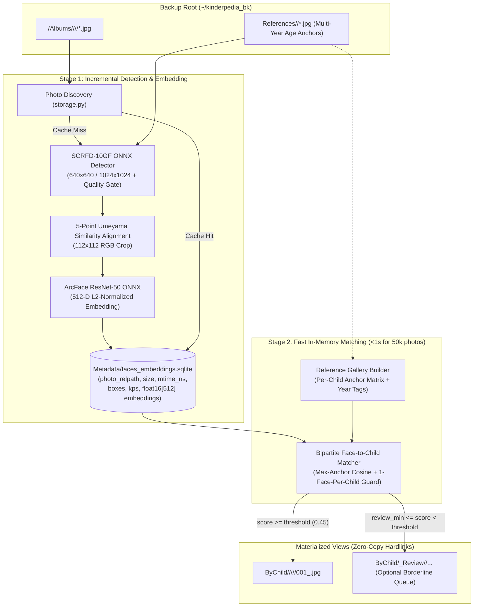

# Local Facial Recognition & Per-Child Photo Organization — Design Doc

**Status:** Proposed (Architecture scaffolded in `python/src/kinderpedia_backup/faces/`)  
**Scope:** Offline ML inference, longitudinal child age-anchor matching, embedding cache, and zero-copy filesystem organization for Kinderpedia archives.

---

## 1. Problem Statement & Real-World Archive Characteristics

Kindergarten classroom albums typically contain **20–300+ group photos per activity** across 3–5 school years (10,000–60,000+ photos per family). Parents want a curated view containing **only the photos (and optionally videos) in which each of their children appears**, without duplicating gigabytes of media on disk or uploading children's biometrics to third-party cloud APIs.

### Domain-Specific Challenges in Kindergarten Media
1. **Rapid Longitudinal Age Progression (Ages 1.5 → 6):** Craniofacial geometry changes substantially between nursery and pre-school. A single reference photo taken at age 6 degrades recall on photos taken at age 2.
2. **Dense Wide-Angle Classroom Shots:** Group activities feature 15–25 small faces (`28×28 px` to `80×80 px`), steep downward head pitch (painting, crafts, sensory play), partial occlusions, and indoor motion blur.
3. **Classroom Background Distractors:** Kindergarten walls are covered with illustrated faces, dolls, posters, and children's book covers that trigger naive face detectors.
4. **Sibling Disambiguation:** Siblings at the same kindergarten often look remarkably similar at the same age (e.g., Child A at age 3 vs. Child B at age 3) and may also appear together in school-wide festival albums.
5. **Zero-Recompute Iteration:** Scanning 50,000+ high-resolution JPEGs takes ~25–45 minutes on a laptop; tweaking similarity thresholds or adding a better reference portrait must re-run in **under 1 second** rather than re-running ML inference.

---

## 2. Goals & Non-Goals

### Goals
- **100% Local Privacy:** All face detection and embedding generation run strictly offline on the user's machine. Model weights are downloaded once from pinned, SHA-256-verified release URLs into `~/.cache/kinderpedia-backup/models/`.
- **Zero-C++-Build Portability (Python 3.10–3.15+):** Run SCRFD + ArcFace ONNX models directly via `onnxruntime`, `numpy`, and `Pillow` — avoiding Cython/`opencv` C++ compilation issues on newer Python releases.
- **Zero Extra Disk Usage:** Materialize matched media into `ByChild/<Child>/<Year>/<Month>/<YYYY-MM-DD Title>/` via POSIX/NTFS **hardlinks** (with automatic fallback to `copy` on cross-volume or FAT/exFAT drives, or optional relative `symlink`s).
- **Decoupled Two-Stage Cache:** Cache raw per-photo face bounding boxes + 512-D embeddings (`float16`) in `Metadata/faces_embeddings.sqlite` so threshold tuning and reference-photo updates complete in `<1s` across 50,000+ photos.
- **Cross-Tool Compatibility:** Operate identically on archives produced by either the Browser Bookmarklet or `kinderpedia-backup sync`.

### Non-Goals
- Cloud-hosted face APIs (AWS Rekognition, Google Cloud Vision, Azure Face).
- Automatic unsupervised clustering without user-supplied reference portraits (`References/<Child>/`) in v1 (may be added later as `--bootstrap-clusters` to help seed reference portraits).
- Modifying or deleting original files inside `<Child>/Albums/`.

---

## 3. System Architecture



---

## 4. ML Model & Pure-ONNX Inference Pipeline

### 4.1 Why Direct `onnxruntime` Instead of `dlib` / `face_recognition` / `insightface` Wrapper
| Candidate | Small/Angled Kid Faces | Python 3.13–3.15 Install | Apple Silicon Acceleration | Verdict |
| :--- | :--- | :--- | :--- | :--- |
| `face_recognition` (`dlib` ResNet-34) | Weak on profile/downward pitch & `<50px` faces | Requires `cmake` + C++ toolchain | CPU only | Reject |
| `insightface` Python package | Excellent (`buffalo_l`) | Compiles Cython C++ extensions (`mesh_core_cython`) — breaks on new Python versions | Via `onnxruntime` | Use models, skip wrapper |
| **Direct `onnxruntime` + `buffalo_l` ONNX** (`det_10g.onnx` + `w600k_r50.onnx`) | **State-of-the-art** (SCRFD-10GF + WebFace600K ArcFace R50) | **Pure wheel install** (`onnxruntime`, `numpy`, `Pillow`) | **`CoreMLExecutionProvider`** + CPU/CUDA | **Selected** |

### 4.2 Inference Steps Per Photo
1. **EXIF Orientation Normalization:** Apply `PIL.ImageOps.exif_transpose(img)` before resizing (critical for portrait smartphone uploads from educators).
2. **SCRFD-10GF Face + 5-Keypoint Detection (`det_10g.onnx`):**
   - Letterbox resize longest edge to `det_size = 640` (configurable `--det-size 1024` for wide outdoor group shots).
   - Decode stride `{8, 16, 32}` anchor-free bounding boxes, confidence scores, and 5 facial landmarks (left eye, right eye, nose tip, left mouth corner, right mouth corner), followed by NMS (`iou_threshold = 0.40`).
   - **Classroom Quality Gate:** Discard detections with `det_score < 0.55` or `min(width, height) < 28 px` in original image coordinates (eliminates wall posters, tiny blurred background silhouettes, and cartoon drawings).
3. **5-Point Similarity Alignment (Pure `numpy`):**
   - Compute the closed-form 2D similarity transform (`Umeyama` SVD, 25 lines of `numpy`) mapping the 5 detected landmarks onto standard ArcFace `112×112` canonical coordinates, and warp via `PIL.Image.transform(..., Image.Transform.AFFINE, resample=Image.Resampling.BILINEAR)`.
4. **ArcFace Embedding (`w600k_r50.onnx`):**
   - Normalize `112×112` RGB crop to `(pixel - 127.5) / 127.5`, run `w600k_r50.onnx` (batched across all faces in the photo), and L2-normalize each 512-D vector ($\|\mathbf{e}\|_2 = 1$).

### 4.3 Hardware Execution Providers (`--backend`)
- `auto` (default): Probes `onnxruntime.get_available_providers()` in priority order:
  1. `CUDAExecutionProvider` (Linux/Windows NVIDIA GPU)
  2. `CoreMLExecutionProvider` (macOS Apple Silicon Neural Engine / GPU — note: pin fixed input tensor shapes `1×3×640×640` and `1×3×112×112` so CoreML compiles the graph once without dynamic-shape fallback!)
  3. `CPUExecutionProvider` (ARM64 NEON / x86 AVX2)

---

## 5. Reference Enrollment & Longitudinal Age-Anchor Matching

### 5.1 Reference Directory Convention (`References/`)
Parents place **3–8 clear portraits per child** spanning the school years present in their archive:

```text
<Backup Root>/References/
├── Alex/
│   ├── 2022_nursery.jpg       # Optional year prefix acts as an age anchor
│   ├── 2024_preschool.jpg
│   └── 2026_portrait.jpg
└── Maya/
    ├── 2025_autumn.jpg
    └── 2026_spring.jpg
```

**Enrollment Validation Rules:**
- If a reference image contains **0 faces** → log an actionable warning (`[WARN] No clear face detected in References/Alex/foo.jpg; skipping`) rather than crashing.
- If a reference image contains **multiple faces** → pick the largest prominent face (`area * confidence`) ONLY if its bounding-box area is $\ge 2.5\times$ the second-largest face; otherwise warn the user to crop the reference image so a classmate isn't accidentally enrolled!
- Compute pairwise intra-child anchor similarities and warn if an outlier reference portrait has `< 0.25` similarity to all other portraits of the same child (catches accidentally dropping a photo of the wrong sibling into `References/<Child>/`).

### 5.2 Multi-Anchor Scoring & Bipartite Sibling Assignment
Given a photo containing $M$ detected faces $\{\mathbf{f}_1, \dots, \mathbf{f}_M\}$ and $K$ enrolled children $\{C_1, \dots, C_K\}$, where child $C_k$ has reference anchor embeddings $\{\mathbf{r}_{k,1}, \dots, \mathbf{r}_{k,n_k}\}$:

1. **Per-(Face, Child) Score:**
   $$S(m, k) = \max_{j \in \{1..n_k\}} \left( \mathbf{f}_m \cdot \mathbf{r}_{k,j} \right)$$
   *(Using `max` over age anchors rather than a single centroid vector is essential for ages 2–6: a 2022 photo matches the 2022 anchor at `0.62` even if its similarity to the 2026 anchor is `0.38`, whereas averaging 2022+2026 into one centroid dilutes both ends.)*
2. **One-Box-Per-Child Exclusivity (Greedy Bipartite Matching):**
   - Sort all candidate pairs $(m, k)$ with $S(m, k) \ge \tau_{\text{min}}$ in descending order of $S(m, k)$.
   - Once face box $m$ is assigned to child $k$, face box $m$ cannot ALSO be assigned to sibling $k'$, and child $k$ is already matched for this photo.
   - If two siblings **both** appear in the same group photo, face $m_1$ assigns to Child 1 and face $m_2$ assigns to Child 2 — both children receive the photo!
3. **Threshold Calibration Defaults:**
   - `--threshold 0.45` (High-precision default for ArcFace R50 on children: `<1%` false-positive rate in group classrooms).
   - `--review-threshold 0.36` (Optional `--include-review`: routes `[0.36, 0.45)` matches into `ByChild/_Review/<Child>/` for quick visual inspection).

---

## 6. Two-Stage SQLite Embedding Cache (`Metadata/faces_embeddings.sqlite`)

Replacing the prototype JSON match cache (`Metadata/face_scan_cache.json`) with a single-file SQLite WAL database (`Metadata/faces_embeddings.sqlite`, using Python's built-in `sqlite3`) gives atomic crash-safe writes during multi-worker scanning and decouples expensive inference from cheap vector math:

```sql
CREATE TABLE IF NOT EXISTS meta (
    key TEXT PRIMARY KEY,
    value TEXT NOT NULL
);

CREATE TABLE IF NOT EXISTS photos (
    rel_path TEXT PRIMARY KEY,          -- e.g. "Alex/Albums/2026/11/2026-11-06 Outdoor Play/001_50753201.jpg"
    file_size INTEGER NOT NULL,
    mtime_ns INTEGER NOT NULL,
    detector_id TEXT NOT NULL,          -- e.g. "scrfd_10g_640_arcface_r50_v1"
    width INTEGER NOT NULL,
    height INTEGER NOT NULL,
    face_count INTEGER NOT NULL,
    scanned_at TEXT NOT NULL
);

CREATE TABLE IF NOT EXISTS faces (
    photo_rel_path TEXT NOT NULL REFERENCES photos(rel_path) ON DELETE CASCADE,
    face_idx INTEGER NOT NULL,
    det_score REAL NOT NULL,
    bbox_json TEXT NOT NULL,            -- [top, right, bottom, left]
    embedding_f16 BLOB NOT NULL,        -- 512 * 2 = 1024 bytes raw IEEE-754 float16
    PRIMARY KEY (photo_rel_path, face_idx)
);
```

### Storage & Speed Profile (for a 55,000-Photo Archive)
- Assuming an average of ~4 quality-gated faces per photo: `55,000 × 4 × 1,024 B` $\approx$ **225 MB** total SQLite database in `Metadata/faces_embeddings.sqlite`.
- Loading all 220,000 `float16` embeddings into a contiguous `numpy` matrix `(220000, 512)` and multiplying against 10 reference anchors `(512, 10)` takes **~180 ms** on Apple Silicon!
- Re-running `kinderpedia-backup faces --threshold 0.42` or adding new reference portraits reconciles all hardlinks in **under 1 second**.

---

## 7. Output Layout & Incremental Reconciliation

### 7.1 Output Hierarchy (`--layout nested` default)
Mirrors the exact `<Year>/<Month>/<YYYY>-<MM>-<DD> <Title>` structure adopted by `sync` and the Bookmarklet:

```text
<Backup Root>/
├── Alex/Albums/...                    # Full classroom archive (untouched source of truth)
├── Maya/Albums/...
├── References/
│   ├── Alex/
│   └── Maya/
├── ByChild/                           # Curated per-child hardlinked views (0 extra GiB)
│   ├── Alex/
│   │   └── 2026/
│   │       └── 11/
│   │           └── 2026-11-06 Outdoor Play/
│   │               └── 004_50753204.jpg
│   └── Maya/
│       └── 2026/
│           └── 08/
│               └── 2026-08-10 Summer Sensory Play/
│                   └── 002_47270370.jpg
└── Metadata/
    └── faces_embeddings.sqlite
```

*(An optional `--layout flat` flag preserves the single-folder `ByChild/<Child>/<YYYY-MM-DD Title>_004_50753204.jpg` layout for digital photo frames that do not recurse subdirectories.)*

### 7.2 Clean Pruning (`--prune`)
When a user raises `--threshold` (e.g., `0.42` → `0.48`), previously created hardlinks in `ByChild/` that no longer meet the threshold can be cleanly unlinked (removing only files inside `ByChild/`, never touching `<Child>/Albums/`) and empty `<Month>`/`<Year>` directories pruned.

---

## 8. Module Map & Implementation Plan

All changes slot cleanly into the existing `python/src/kinderpedia_backup/faces/` subpackage without breaking existing CLI flags:

| File | Responsibility |
| :--- | :--- |
| `faces/weights.py` *(new)* | Downloads `det_10g.onnx` (~16 MB) & `w600k_r50.onnx` (~166 MB) once to `~/.cache/kinderpedia-backup/models/` with **pinned SHA-256 checksum verification** and atomic `.part` rename. |
| `faces/alignment.py` *(new)* | Pure-`numpy` + `Pillow` SCRFD anchor decoding, NMS, and 5-point Umeyama similarity alignment (`112×112`). |
| `faces/onnx_backend.py` *(new)* | Concrete `OnnxScrfdArcFaceRecognizer` implementing `FaceRecognizer` (`recognizer.py`), wired into `load_default_recognizer("auto")`. |
| `faces/cache_db.py` *(new)* | SQLite WAL `EmbeddingStore` (`Metadata/faces_embeddings.sqlite`) storing `float16` vectors + stale-entry invalidation on `(size, mtime_ns)`. |
| `faces/pipeline.py` *(update)* | Multi-anchor max scoring, bipartite 1-box-per-child assignment, reference outlier warnings, `--layout {nested,flat}`, `--review-threshold`, and `--prune`. |
| `pyproject.toml` *(update)* | Define `[project.optional-dependencies] faces = ["numpy>=1.24", "onnxruntime>=1.17", "Pillow>=10.0"]`. |

### Phased Rollout
1. **Milestone 1 (Core Photo Pipeline):** `weights.py` + `alignment.py` + `onnx_backend.py` + `cache_db.py` + nested `ByChild/<Child>/<Year>/<Month>/...` output + offline unit tests with synthetic/tiny fixture tensors.
2. **Milestone 2 (UX & Calibration):** `kinderpedia-backup faces --check-refs` diagnostic command (prints enrolled reference quality & cross-sibling similarity matrix before scanning) + `--review-threshold` borderline folder + live terminal progress bar (`LiveProgress`) with photos/sec & ETA.
3. **Milestone 3 (Video Keyframe Matching, Optional):** `--include-videos` flag extracting 1 keyframe every 2s via `ffmpeg` into memory pipes, matching faces against the same anchor profiles, and hardlinking matching `.mp4` videos into `ByChild/<Child>/<Year>/<Month>/<Album>/`.
